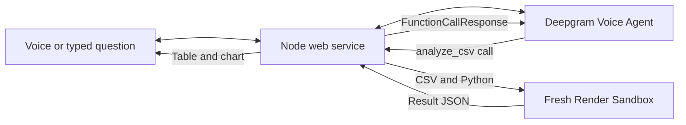

<div align="center">

# Sidekick

Ask a question about a CSV. Get a calculated answer, a chart, and a table you can download.

**Deepgram Voice Agent API + Render Sandboxes**

[Quickstart](#quickstart) · [How it works](#how-it-works) · [Checks](#checks) · [Limits](#limits)

</div>

Sidekick starts with a fictional shop's monthly sales data. Ask “Which products explain the revenue drop?” by voice or text. Deepgram writes a small Python program, a fresh Render Sandbox runs it against the complete CSV, and the answer appears next to the conversation. The agent also speaks the result when voice is enabled.

This is a community integration prototype, not an official Deepgram or Render partnership.

## Quickstart

You need Node.js 24 or later, a Deepgram API key with Voice Agent access, and a Render API key for a workspace with Sandboxes enabled.

Run these commands in your terminal:

```sh
# Download this repository and enter its folder.
git clone https://github.com/ojusave/deepgram-render-sandbox.git
cd deepgram-render-sandbox

# Install the exact dependency versions and create local server settings.
npm ci
cp .env.example .env
```

Open `.env` and fill in `DEEPGRAM_API_KEY`, `RENDER_API_KEY`, and `RENDER_WORKSPACE_ID`. Credentials stay on the server. Never add them to browser code or commit them.

```sh
# Package the interface, then start the local server.
npm run build
npm start
```

Open [localhost:4399](http://localhost:4399). Choose **Which region performed better?** The fictional sample totals are **West: $65,000** and **East: $56,500**. Open **Activity** to see the generated Python and confirmed sandbox cleanup.

Choose **Talk** to allow microphone access. **End voice** releases the microphone. **Stop** ends the connection and stops any active calculation. You can always type instead.

## How it works



A **function call** is a request from the agent to run a specific action. Deepgram requests `analyze_csv` with Python code. The server uploads the complete CSV and that code, runs Python, collects a bounded JSON file, validates its shape, and confirms the sandbox has stopped. It returns the result to Deepgram so the agent can continue speaking.

The browser uses Deepgram's microphone and playback helpers. The Node server owns the voice WebSocket, a continuous two-way connection. Browser messages cannot replace provider settings or invoke the execution tool directly.

The tool uses `defer_until_eot: true`, which waits until the speaker finishes before starting execution. Cancelled calls abort their work and receive no late result. Closing the conversation also stops active execution.

- [Voice configuration](server/settings.js): prompt, managed language model, speech models, and the tool definition.
- [Sandbox runner](server/sandbox.js): offline execution, bounded file collection, cancellation, and confirmed cleanup.
- [Web server](server/index.js): visitor sessions, audio relay, uploads, and downloads.
- [Interface](web/app.js): voice/text controls, chart, tabs, and adjustable panes.

The interface uses browser JavaScript and CSS. Express handles web requests, `ws` handles the voice connection, `csv-parse` reads spreadsheet text correctly, and Zod validates the returned data. Provider-specific behavior is kept in the configuration and sandbox modules. Dependencies are pinned in `package-lock.json`.

## Deploy on Render

Use a paid **Starter** Node web service in Oregon:

| Setting | Value |
| --- | --- |
| Build | `npm ci && npm run build` |
| Build environment | `NODE_ENV=production`, `NPM_CONFIG_INCLUDE=dev` (includes the interface build tools) |
| Start | `npm start` |
| Health check | `/healthz` |
| Instances | One |
| Server settings | `DEEPGRAM_API_KEY`, `RENDER_API_KEY`, `RENDER_WORKSPACE_ID`, and a long random `SESSION_SECRET` |
| Node | 24 or later |

Render supplies `PORT`; the server binds to `0.0.0.0`. Keep one instance because this prototype stores visitor sessions and limits in memory. Deploying or restarting clears those sessions.

## Checks

```sh
# Fast validation of input, result shape, cancellation, and cleanup without API costs.
npm test

# With the server running, exercise real Deepgram and Render calls.
# These checks consume provider usage and stop their disposable sandboxes.
npm run test:live
node --env-file=.env scripts/voice-test.js
node --env-file=.env scripts/sandbox-live-test.js

# Point the typed end-to-end check at your hosted app instead.
BASE_URL=https://your-service.onrender.com npm run test:live
```

The voice check streams an included synthetic spoken question, not your microphone. Its text is “Which region had the most revenue? Compare the totals for East and West.” Physical microphone and speaker behavior still depends on the user's browser and device.

The typed check validates expected totals, actual returned speech bytes, downloadable CSV, and separation between two visitor sessions. The sandbox check exercises cancellation, absence of host credentials, and blocked outbound connectivity.

## Limits

- CSV only, up to 500 KB, 10,000 rows, and 30 uniquely named columns. Preview shows up to 30 rows; calculations read all rows.
- Standard-library Python only. No package installation or outbound network access. Each sandbox has a 180-second maximum lifetime; the Python process has a 20-second execution limit.
- Two simultaneous conversations/calculations, up to eight calculations per conversation, 30 conversation starts per hour, and 100 per day across one server process. Conversations close after 90 seconds without user activity or five minutes total. Limits reset on restart.
- A signed browser cookie separates visitors. Uploads, conversation text, generated code, and results are held in server memory for up to one hour of inactivity. A restart clears them. No durable database is configured.
- Audio and questions are processed by Deepgram and its managed language-model provider. Column names and five example rows enter the agent context. The full CSV and generated program go to Render Sandboxes. The collected result returns to the app and Deepgram. Use sample data.

The result validator checks structure, not the mathematical meaning of arbitrary generated programs. Review the answer and code before relying on them. Unknown creation outcomes or unconfirmed cleanup block additional calculations on that server rather than automatically creating another sandbox.

## References

- [Deepgram browser audio helpers](https://developers.deepgram.com/docs/browser-agent-javascript)
- [Deepgram function calling](https://developers.deepgram.com/docs/voice-agents-function-calling)
- [Deepgram cancellation events](https://developers.deepgram.com/docs/voice-agent-function-call-cancelled)
- [Render Sandboxes TypeScript SDK](https://render.com/docs/sandboxes-sdk-typescript)

## License

[MIT](LICENSE)
